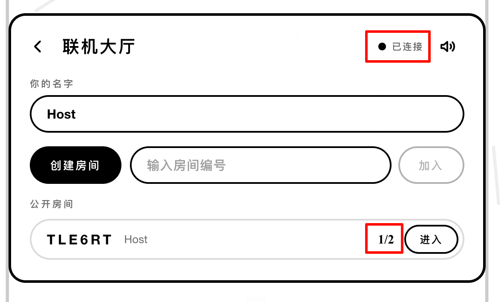
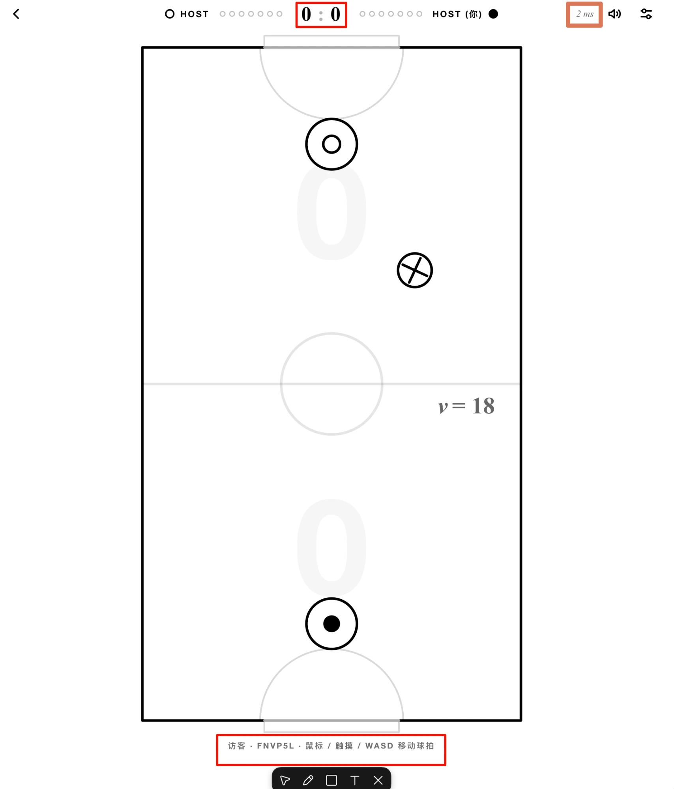
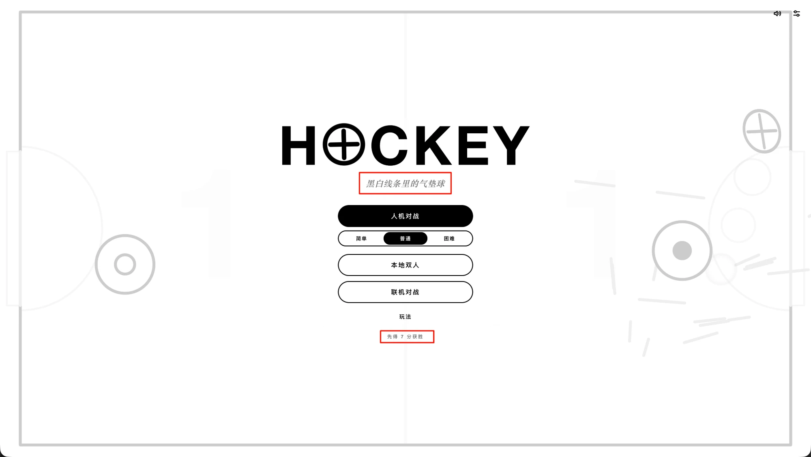
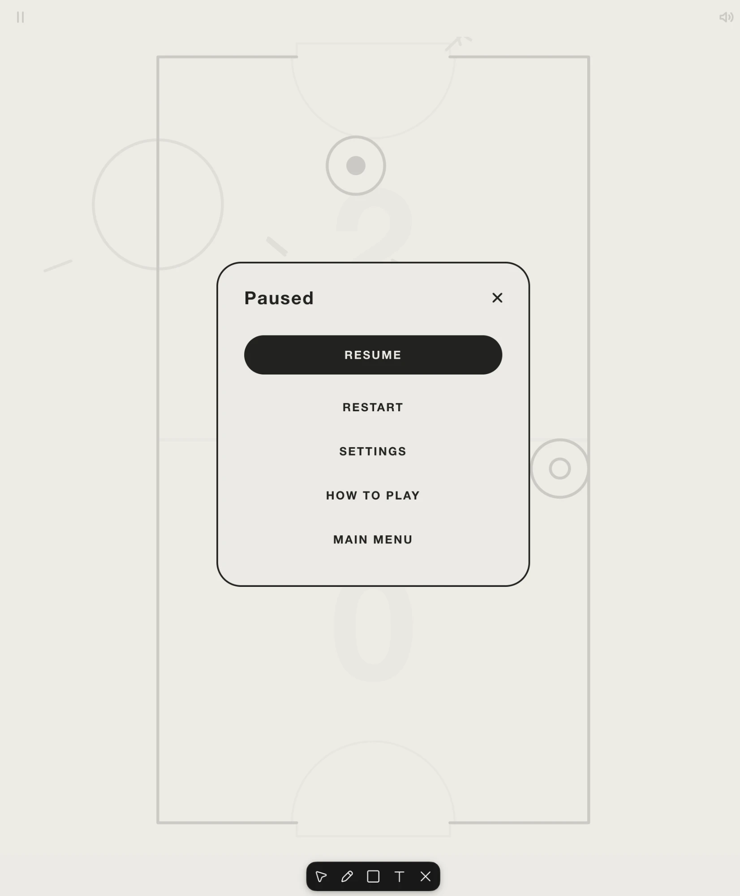

# Hockey 聊天记录

### 用户消息 · 2026-10-19 Asia/Shanghai

setup-matt-pocock-skills ask-matt 这是我今年1月份做的hockey网页联机游戏，请先理解整个项目，理解游戏里每个元素和操作的意思，写好术语，然后给我核对。顺便问下这步操作应该使用哪个或者哪些matt skill最好，请使用。

### 用户 skill 引用 · 2026-10-19 Asia/Shanghai

ask-matt

### 用户 skill 引用 · 2026-10-19 Asia/Shanghai

setup-matt-pocock-skills

### 用户结构化回答 · 2026-10-19 Asia/Shanghai

问题：项目远程仓库是 Crisply2404/Hockey。后续 Matt skills 应当把任务记录在哪里？

回答：为什么你推荐写到issues里而不是仓库内的markdown文件？

### 助手最终回复 · 2026-10-19 Asia/Shanghai

- [术语表](/Users/hco/Documents/Crisply2404.github.io/Hockey/GLOSSARY.md)：61 项术语，供你核对。
- [项目说明](/Users/hco/Documents/Crisply2404.github.io/Hockey/docs/project-understanding.md)：画面元素、操作、规则、AI、联机职责与源码依据，文末列出核对问题。

已使用 `ask-matt`、`domain-modeling`。前端构建和本地房间操作核查通过；TypeScript 检查缺少 Cloudflare 类型。

GitHub Issues 的推荐来自 setup skill 对 GitHub remote 的默认规则；当前个人项目使用仓库 Markdown 也合适。

Matt 初始化等待任务记录位置的选择。[setup-matt-pocock-skills](/Users/hco/.agents/skills/setup-matt-pocock-skills/SKILL.md) 要求“confirm with the user, then write”。

浏览器自动检查拒绝访问本地页面，原因是无法核验管理员策略；页面交互尚未验证。

### 用户结构化回答 · 2026-10-19 Asia/Shanghai

问题：术语表和项目说明已经写入仓库。Matt 初始化还需要确定后续任务的记录位置，你选择哪一种？

回答：仓库内的markdown文件。还有我希望你能帮我完善联机服务，就用cf worker，不要让玩家还要自己填wss

### 用户结构化回答 · 2026-10-19 Asia/Shanghai

问题：Matt 的任务分类是否保留默认名称？推荐保留：needs-triage、needs-info、ready-for-agent、ready-for-human、wontfix。

回答：保留默认名称（推荐）

### 用户结构化回答 · 2026-10-19 Asia/Shanghai

问题：请核对配置草稿：/Users/hco/Documents/Crisply2404.github.io/Hockey/.scratch/hockey-analysis/matt-setup-draft.md。项目根目录目前没有 agent 入口文件，你希望把草稿中的入口规则写到哪个文件？

回答：AGENTS.md（推荐）

### 助手最终回复 · 2026-10-19 Asia/Shanghai

Cloudflare Worker 联机服务已部署，`https://hockey-lobby.tcoinsm.workers.dev/health` 返回正常。Hockey 前端会自动连接 Worker，玩家只需要分享六位房间编号。房主计算比赛，双方同步输入、比分和比赛效果。

本地 `npm run check`、`npm run build` 和四项 `npm run test:online` 检查通过。生产 WebSocket 握手成功并返回房间列表初始状态；执行环境运行完整生产 WebSocket 测试时遇到网络超时。

[术语表](/Users/hco/Documents/Crisply2404.github.io/Hockey/GLOSSARY.md)和[项目说明](/Users/hco/Documents/Crisply2404.github.io/Hockey/docs/project-understanding.md)已更新，术语核对问题在说明文末。已使用 `ask-matt`、`domain-modeling` 和 `setup-matt-pocock-skills`；Matt 配置使用本地 Markdown 任务与默认分类名称。

Hockey 源码目前还在本地工作区。推送更改并运行主站 `deploy.yml` 后，主站 `/hockey/` 才会显示新的联机页面；玩家无需填写 WSS 地址。

### 用户消息 · 2026-10-20 Asia/Shanghai

conversation-and-commits 请你遵守我这个skill的规则，进行commit

### 用户 skill 引用 · 2026-10-20 Asia/Shanghai

conversation-and-commits

### 用户追加消息 · 2026-10-20 Asia/Shanghai

注意你每次commit后直接push就行

### 助手最终回复 · 2026-10-20 Asia/Shanghai

Hockey 已提交并推送：`17da8fb`（术语与配置）、`ca86378`（联机功能与测试）。

主站发布说明与聊天记录也已提交并推送。类型检查、构建和四项联机测试通过，两个工作区均无未提交更改。

### 用户消息 · 2026-10-20 Asia/Shanghai

不对吧，你应该用的是这个工作目录里的/Users/hco/Documents/Crisply2404.github.io/Hockey/docs下的CHAT_HISTORY.md，而不应该用上一级的。你修改一下然后push force with lease

### 助手最终回复 · 2026-10-20 Asia/Shanghai

聊天记录已保存到 [docs/CHAT_HISTORY.md](/Users/hco/Documents/Crisply2404.github.io/Hockey/docs/CHAT_HISTORY.md)，后续沿用此路径。主站聊天文件已恢复，两个仓库均已完成 `--force-with-lease` 推送。

### 用户消息 · 2026-11-25 Asia/Shanghai

我觉得目前Hockey太简陋了，你能不能直接一步到位弄成一个像样的成品？按聊天记录和提交的规则

### 助手最终回复 · 2026-11-26 Asia/Shanghai

Hockey 已经做成完整的游戏，并提交推送到 `main`。物理手感和原有的打击效果没有改动。

**新增**

- 主菜单：标题、人机对战（简单 / 普通 / 困难）、本地双人、联机对战、玩法、设置，背后是电脑自己对打的演示比赛。
- 比赛流程：发球倒计时、顶部比分栏、暂停（Esc / P，切到后台自动暂停）、结算面板（比分、用时、最高球速、最长回合、击球数）和再来一局。
- 声音：击球、撞墙、屏障、进球、胜负全部即时合成，不带音频文件。
- 设置：音量、画面震动、黑白主题、中英文、局分 3 / 5 / 7，保存在浏览器里。
- 触屏和竖屏：本地双人可以两个人各按自己的半场；竖屏时球桌转 90°，自己的半场在下方。
- 联机：进大厅才连接服务；邀请链接（`?room=编号`）点开直接进房间；访客画面做了插值，自己的球拍本机先动；房主可以再来一局。
- 去掉了 Tailwind CDN 和 esm.sh，页面不再加载任何外部资源。

**你需要知道的**

- 困难档就是原来的 AI，默认档改成了普通。
- 联机协议和 Worker 没有改，不用重新部署 Worker。主站 `/hockey/` 要重新跑一次主站的 `deploy.yml` 才会更新。
- 联机固定 7 分，再来一局只有房主能点；房主把页面切到后台时比赛会停住。
- 术语表、项目说明同步更新了，另加了一份 ADR 记录联机这部分的取舍。

**验证**

类型检查、构建、4 项联机测试和新增的 4 项访客画面平滑测试都通过。浏览器里核对了主菜单、人机整局到结算、暂停、设置和黑色主题、双指触屏、手机竖屏、邀请链接加入和联机整局。

没有验证的：两台设备走正式 Worker 的联机手感、真实触屏设备，以及声音好不好听（只确认了不报错）。

本地开发服务器还开着，可以在浏览器面板里直接玩：http://localhost:3000

### 用户消息 · 2026-11-26 Asia/Shanghai

你的ui的辅助性重复性说明太多了，没必要在标题下面加个副标题，也没必要在标题界面最下面说3分获胜。还有你觉得这游戏本身有没有要改良的？比如粒子特效，赢了之后的效果，门被撞碎的效果，这游戏的ai，以及这游戏的各种判定。总之你觉得这游戏哪些地方应该重构？或者做得更好？注意提出意见之前先确认你看了并理解了这些地方原来是什么样子。还有我不喜欢我红框框住的东西，我觉得那个已连接看着突兀，而且我不喜欢这游戏数字的字体，看着很丑。而且我觉得这游戏的黑和白的差别太大了，能用更好一点的monochrome配色吗。总之我不希望ui那么挤，我觉得ui肯定是要重构一下的。还有我觉得繁琐的测试都可以去掉，主要靠我们打开网页自己测试。因为我看你测试花了很多时间

### 助手最终回复 · 2026-11-26 Asia/Shanghai

界面已经按你的意见重做并推送。游戏本身我没有动，下面第二部分是我的看法，等你定先改哪块。

## 界面改了什么

- 删掉了重复和说明性的文字：副标题、主菜单底部的“先得 N 分获胜”、比赛顶部的比分和名字、延迟、底部的操作说明、大厅的“已连接”和房间人数。
- 比分只留球桌上那两个大数字，比原来深了一点。比赛画面顶部只剩暂停和声音两个图标。
- 大厅没连上时，“创建房间”按钮显示“连接中…”；房间列表只列还能进的房间，没有就不显示。
- 界面里的数字都换成和文字一样的无衬线字体。球桌上的 `v = N` 是原来就有的，你没有框它，我没动；你要是也不喜欢，我一起换。
- 配色从纯黑纯白换成纸色 `#eceae4` 配墨色 `#222220`，黑色主题是 `#191918` 配 `#dedcd6`，画布和界面用同一套。
- 间距整体放宽，面板边线从 3px 减到 2px。
- 我加的单元测试和调试钩子删了。上一轮留下的 `tests/online.test.ts`（Worker 房间测试）没删，要删告诉我。

这版我只做了类型检查和构建，看了主菜单、比赛画面、大厅三屏。黑色主题、结算面板、暂停面板、等待面板没看，交给你打开网页试。

## 游戏本身我觉得该改的

原来的 `components/Hockey.tsx` 我整个读过。每条先说现在是怎样的，按我认为的优先级排。

**1. 判定：有几处是实打实的问题，建议先修**

- 球拍击球后有 20 帧不参与碰撞（[Hockey.tsx:981](components/Hockey.tsx:981)）。这三分之一秒里球弹墙回来会直接穿过球拍。
- “轻触”只对左方生效（[Hockey.tsx:992](components/Hockey.tsx:992) 的 `p === s.p1`）。本地双人和联机时右方没有这条规则，两边手感不一样。
- 超速衰减是按帧算的（[Hockey.tsx:1270](components/Hockey.tsx:1270)），碎片摩擦和彩条阻力也是。120Hz 的屏幕上球掉速快一倍。
- 连击爆发的方向完全随机（[Hockey.tsx:999](components/Hockey.tsx:999)），可能直接弹进自己的门。
- 屏障的击破门槛是水平速度 6（[Hockey.tsx:41](components/Hockey.tsx:41)），而冰球的最低速度本来就是 6，所以正面球几乎都是一下破门直接进，屏障只挡得住擦边球。门两端各 24px 无论多快都会弹回（[Hockey.tsx:922](components/Hockey.tsx:922)），160 宽的门实际只有中间 112 能进。这两条算不算问题取决于你想让屏障起多大作用，需要你定。

**2. AI：建议重写移动部分**

- 现在它在冰球进入己方区域后直线冲向“冰球左边 25px”（[Hockey.tsx:467](components/Hockey.tsx:467)），靠撞上去出球，没有瞄准。出球能进门，靠的是击球后直接改写冰球的旋转把球“弯”进去。
- 拦截预判不算撞墙反弹（[Hockey.tsx:470](components/Hockey.tsx:470)）。按代码逻辑，冰球在它身后时它会从前面追上去，把球推向自己的门；这一点我没有实际打出来确认。
- 防守站位写的是 x=740（[Hockey.tsx:456](components/Hockey.tsx:456)），在禁区里面，实际一直被挤在禁区弧线上。
- 我加的简单和普通只是降速加偏差，打法和困难是同一套。
- 我的建议是分成防守（站在球和门的连线上）、拦截（用现有的预测模拟把反弹算进去）、进攻（绕到球后面对准目标再打）、回追四种状态，难度用反应延迟和瞄准误差来区分。

**3. 破门**

- 现在屏障瞬间消失，6 段灰线向球桌外飞（[Hockey.tsx:321](components/Hockey.tsx:321)），大部分飞出画面看不到。破门那一下没有击球停顿，要等冰球完全出界才进慢动作。
- 建议以撞击点为中心碎开，碎片更多更碎，一部分往场内溅；破门瞬间加一次短停顿。

**4. 获胜**

- 现在 220 根彩条从胜方半场边缘喷进来（[Hockey.tsx:262](components/Hockey.tsx:262)），用纯红、绿、蓝、紫、黄，是全游戏唯一的彩色，喷完就停在地上。
- 获胜后慢动作系数停在 0.1 没有复位，所以赢了以后球拍跟手是慢十倍的。彩条的速度是在这个慢动作下调出来的，复位时要一起重调。
- 彩条保留彩色还是收成墨色加蓝红两色，看你想不想让“彩色”只在赢的时候出现。

**5. 粒子**

- 现在每次碰撞固定出 5 根灰色火花加一个波纹，不分轻重（[Hockey.tsx:358](components/Hockey.tsx:358)）。最低速度蹭一下墙也有波纹，画面上经常挂着好几个圈。
- 火花带重力往下掉，但这是俯视的球桌。
- 建议数量和长度跟力度走，轻碰不出波纹，去掉重力改成沿反弹方向散开再减速。

**6. 结构**

- 整个游戏是一个约 1700 行的 `useEffect`，物理、输入、AI、联机、绘制写在一起，粒子和震动是在绘制代码里更新的。另有约 200 行已经关掉的“停顿调节”代码（[Hockey.tsx:112](components/Hockey.tsx:112)）。
- 建议拆成模拟、AI、绘制、效果四块，模拟改成固定 60Hz 步长，顺带解决第 1 条里的刷新率问题。这一步目标是手感不变，但改动面最大，改完需要你重新打几局确认。

我建议的顺序是 1、2，然后 3 到 5，第 6 条和第 1 条一起做。你想先改哪块？

### 用户消息 · 2026-11-26 Asia/Shanghai

我重构不仅是要细微改动，而是可能会大改。比如，获胜后，你觉得就应该喷出彩条吗？没有其他更好的效果吗？我要的重构是有可能动摇根基的，但我不在乎，我在乎的是做出成品而且具有我个人的风格，并且看上去不臃肿，不平庸

（这一轮在实现途中中断，助手没有发出最终回复。回答并入下一轮。）

### 用户消息 · 2026-11-26 Asia/Shanghai

这个pause弹窗让我感觉和这个游戏是脱离的，就好像这是不属于这个游戏的东西。为什么我会这么觉得？分析一下原因，以及你觉得应该怎么办？还有哪些像这样的应该改进？那些优秀的网页设计为什么不会出现这种问题？举例说明

### 助手最终回复 · 2026-11-26 Asia/Shanghai

你的感觉是对的：这个弹窗是从“网页应用”那套东西里搬来的，没有一样是从这张球桌里长出来的。暂停我已经改掉当示范，其余的列在下面等你点头。

## 为什么它像外来的

1. **形状不是这个游戏的。** 球桌上只有两种形状：直线和正圆。弹窗带进来了大圆角矩形和胶囊形按钮，这两种形状在球桌上一处都没有。
2. **它盖在游戏上面。** 它有自己的边框，把球桌正中间挡住，后面的球桌被压成 20% 的淡影。游戏成了壁纸，弹窗像是另一个程序开的窗口。
3. **它的结构是办公软件对话框的结构。** 标题、右上角的叉、一个主按钮、一串次按钮。“Paused”说的是你已经知道的事；叉、RESUME、Esc 三样做的是同一件事。
4. **最重的一块黑是一个按钮。** 游戏里除了右方球拍中心那个小圆点，没有任何实心的黑。弹窗一出来，全屏最抢眼的东西变成了 RESUME。
5. **字是营销网页的字。** 全大写加宽字距的粗体是落地页的习惯；标题却是首字母大写。一个框里两种说话方式，哪种都不是游戏自己的。
6. **它不按这个游戏的方式动。** 这个游戏本来就有“时间停住”的画法：击球停顿，冰球定格，画出速度和旋转箭头。暂停是同一件事，却用了网页的淡入。

根子上是我做的时候走了最顺的那条路：要暂停，所以要暂停菜单，所以要弹窗，所以要标题、关闭、主按钮。每一步都是任何人第一个想到的那个，这正是你在“我讨厌的东西”里写的那一条。再加上我把界面做成了画布之外的另一层，有自己的一套按钮和面板，两套东西自然长成两个样子。

## 暂停现在怎么做的

- 不弹任何东西。球桌原样留在画面上，颜色不变，时间停住。
- 冰球上画出此刻的蓝色速度箭头，有旋转时再画红色旋转箭头，和击球停顿是同一种画法。
- 左上角的暂停图标变成三角，旁边多出“重新开始”“返回菜单”两个词，直接写在纸面上，没有框。
- 设置和玩法不再从暂停里进。

截图已经发给你。这版只做了类型检查和构建，看了这一屏。

## 还有哪些是同一个毛病

- 设置面板、玩法面板、离开房间的确认：同一个圆角卡片加叉。
- 结算面板：一张卡片盖在球桌中间，里面是标题、比分、三项统计、两个按钮。
- 大厅：圆角卡片里一张网页表单，灰底输入框。
- 等待对手的面板。
- 主菜单的胶囊按钮和三段式难度选择。
- 右上角的“设置”图标，是软件界面的滑杆图标。
- 游戏内部也有：获胜的彩条，带重力往下掉的火花。它们同样是从别处拿来的现成效果，不是这张球桌自己的东西。

## 好的设计为什么没有这个问题

它们先定下很少的几样材料，然后连菜单、暂停、报错这些“杂事”也只准用这几样来做，不去拿通用组件。下面的例子是凭记忆举的，没有逐个重新打开核对。

- **Mini Metro**：主菜单本身是一条地铁线，选项是线上的站。
- **Super Hexagon**：选关画面就是那个在转的六边形，字和游戏里是同一种，跟着场地一起转。
- **140**：没有菜单，选关就是滚进一扇门。
- **Baba Is You**：菜单用的是关卡里那种会抖的像素字，选关是一张可以走的地图。
- **Chrome 断网时的小恐龙**：GAME OVER 和重开按钮是同一张像素图里的图块，画在同一块画布上。
- **Wordle**：玩法说明直接用真的字母格子来举例，键盘用的也是格子的那三种颜色。

共同点是：你在任何一个画面截一小块下来，都认得出是哪个作品。

## 上一条消息欠你的回答

上一轮我做到一半断了，没有回你。我对“赢了该不该喷彩条”的回答是不该。我想的方向是让球桌上已有的线自己有反应：

- **获胜**：不喷东西。把这一局每个进球的球路按顺序重画一遍，最后留在桌面上的是这一局的一张线图，每局都不一样。
- **撞墙**：去掉火花和波纹，边墙像被拨了一下的弦那样抖。
- **屏障**：像一根皮筋，慢球被兜住弹回，快球把它绷断。

目前只写了弦的形状计算（`src/game/strings.ts`，还没接进游戏，也没提交）。

要不要按“只用球桌自己的材料”这条规矩，把上面列的界面和这三处效果一起重做？

### 用户消息 · 2026-11-26 Asia/Shanghai

我重构不仅是要细微改动，而是可能会大改。比如，获胜后，你觉得就应该喷出彩条吗？没有其他更好的效果吗？你觉得现在的球和球拍的大小就是最好的了吗，没有应该改进的了吗？我要的重构是有可能动摇根基的，但我不在乎，我在乎的是做出成品而且具有我个人的风格，并且看上去不臃肿，不平庸。还有我觉得pause应该出现弹窗，但是弹窗的线框不要让它看上去像是游戏外的东西，可以和球台的线框的粗细一致（不知道我说的有没有道理，还是说有你觉得更好的方式？）

### 助手最终回复 · 2026-11-26 Asia/Shanghai

这次按“动根基”做了，已推送。我给整个游戏定了一条规矩：**效果和界面只用球桌上本来就有的材料**——纸色、墨色、一种线宽、直线、正圆、停顿时的蓝红箭头。下面是按这条规矩得到的东西，两张截图已经发给你。

## 你问的三件事

**彩条。** 不该喷。现在一局结束后，球拍和冰球淡出，球桌退成淡底，这一局每个进球的球路按顺序重画一遍，每画一条响一个音，最后留在桌上的是这一局的线图：胜方的球路深，负方的浅，弧线球就是一条弧线。每一局的图都不一样。

**球和球拍的大小。** 不是最好的，偏大。按球桌短边算，原来球拍直径占 13%，真实的气垫球桌大约 8%。物件太大，球路和弧线没有地方展开，画面也挤。我把球拍半径从 30 改到 26，冰球从 20 改到 15。这是手感上的改动，需要你打几局判断；数字集中在 `src/game/table.ts`，改回去只要改两行。

**暂停弹窗。** 你说得有道理，我往前多走了一步：不只是暂停，界面上所有的线都和球桌一样粗。画布把边墙在屏幕上的实际粗细交给界面，方框、输入框的底线、图标、下划线都用它，窗口放大缩小时一起变。弹窗是直角的方框，里面直接写三个词，没有标题、叉和实心按钮。背后的球桌不变暗，冰球上画着此刻的速度箭头。

你截的那个蓝圈是键盘焦点的提示环，已经去掉。

## 其余跟着改的

- **撞墙**：去掉了火花和波纹。边墙是弦，撞到哪里哪里被拨一下，抖几下停住；声音是五声音阶上的一个音，位置不同音高不同。
- **屏障**：是一根皮筋。慢球被兜住弹回；快球顶着它出界，在慢动作里绷断。击破门槛从 6 提到了 12，不然“兜住”几乎不会发生。
- **AI**：重写了。它推算球路（算反弹），绕到球的后面，再朝你不在的那一侧挥拍；不再直线撞球，也不再偷偷改球的旋转。三档的区别是速度、反应延迟和准头。
- **判定**：击球后球不再穿过球拍；轻触规则对双方都生效；连击爆发改成背离球拍弹出；超速衰减不再受屏幕刷新率影响。
- **结构**：原来 1700 行的一个函数拆成了模拟、AI、画面三个模块。已经关掉的“停顿调节”代码删了，需要的话在 Git 历史里。
- **界面**：主菜单只剩标题和几个词。设置面板、玩法说明、结算统计、音量滑杆、局分选择都删了；开关只留声音、黑白、语言。局分固定 7 分。

## 需要你判断的

- 球拍和冰球的新大小。
- 屏障门槛 12 是不是合适。
- 三档 AI 的强弱。数值是我估的，没有经过对局调校。
- 玩法说明和设置面板删掉之后，有没有你想要回来的。

## 没有核对的

只做了类型检查和构建，看过主菜单、对局画面、暂停弹窗和演示比赛的结尾线图。屏障绷断的样子没截到；声音、黑色主题、大厅和房间的新界面、触屏都没看；联机在这次重写之后没有跑过。演示时发现并修了一个 AI 不去接贴墙球的问题，类似的问题可能还有。
